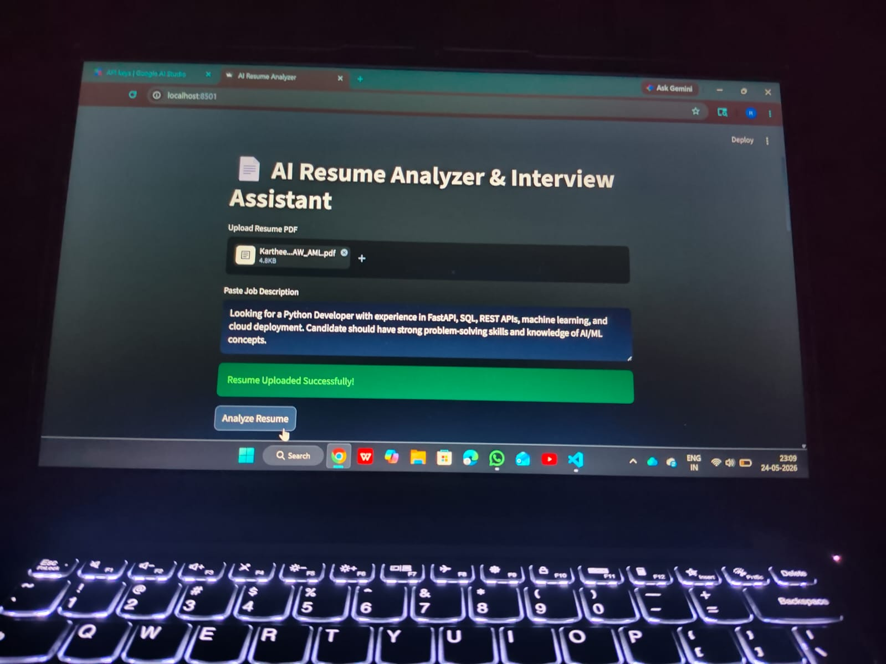

# 📑 AI Resume Analyzer & Interview Assistant

An AI-powered Resume Analyzer built using Streamlit and Google Gemini API.

This application analyzes resumes against job descriptions and provides ATS-style feedback, skill gap analysis, and interview suggestions.

---

## 🚀 Features

- Upload Resume PDF
- Paste Job Description
- ATS Compatibility Analysis
- Skill Gap Detection
- Resume Suggestions
- Interview Question Suggestions
- Streamlit Interactive UI

---

## 🛠️ Tech Stack

- Python
- Streamlit
- Google Gemini API
- PyPDF2
- dotenv

---

## 📂 Project Structure

```bash
ai-resume-analyzer-interview-assistant/
│
├── streamlit_app.py
├── requirements.txt
├── .gitignore
├── README.md
└── resume-ui.jpeg
```

---

## 📸 Project UI



---

## ⚙️ Installation

### Clone Repository

```bash
git clone https://github.com/kartheek-r/ai-resume-analyzer-interview-assistant.git
```

### Move into Project Folder

```bash
cd ai-resume-analyzer-interview-assistant
```

### Create Virtual Environment

```bash
python -m venv venv
```

### Activate Virtual Environment

#### Windows

```bash
venv\Scripts\activate
```

#### Mac/Linux

```bash
source venv/bin/activate
```

### Install Dependencies

```bash
pip install -r requirements.txt
```

---

## ▶️ Run Application

```bash
streamlit run streamlit_app.py
```

---

## 👨‍💻 Author

Karthik R

